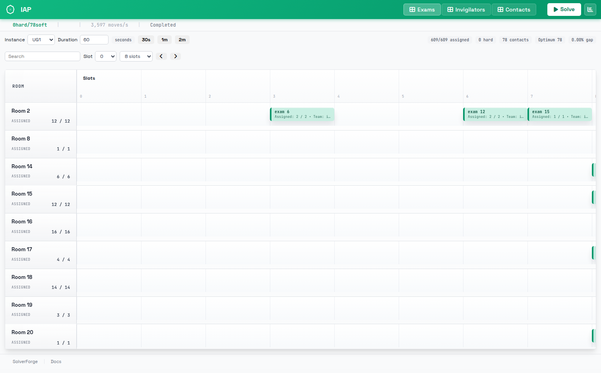
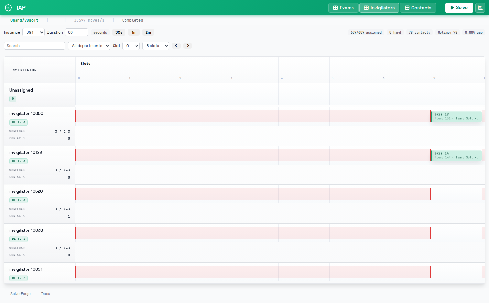
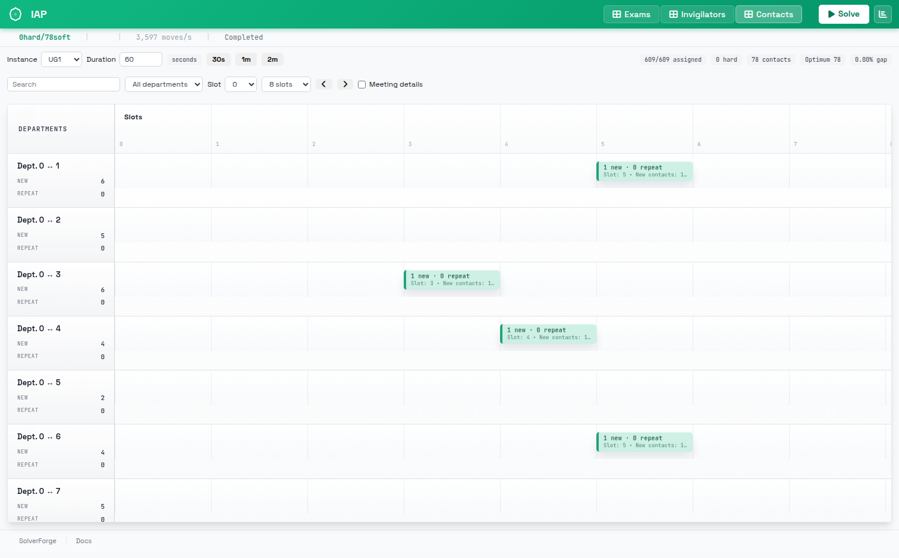
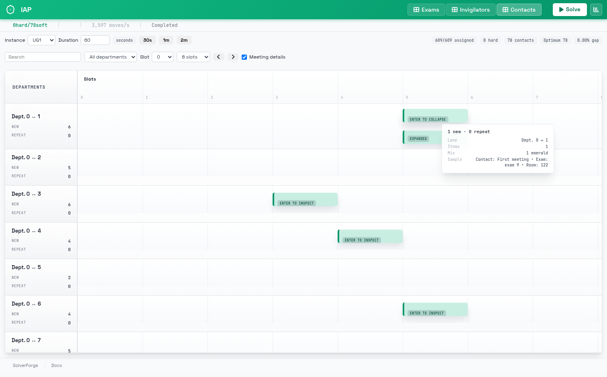

# solverforge-iap


**Invigilator assignment for exam timetables, solved natively in Rust with
[SolverForge](https://crates.io/crates/solverforge), for the two
interaction-oriented objectives of the
[PATAT 2026 invigilator study](https://patatconference.org/patat2026/submissions/PATAT_2026_paper_8723.pdf).**

Vigil (right) is the hall invigilator: clipboard of exam assignments,
availability on the lanyard, always counting who meets whom.

## The problem

A university publishes an exam timetable: exams in rooms at fixed timeslots.
Every exam needs a required number of invigilators, and every invigilator has
a working life around those sessions. An assignment has to satisfy three hard
families:

- **Availability** — an invigilator may only supervise in the timeslots they
  declared available in the instance data.
- **Single occupancy** — an invigilator supervises at most one exam per
  timeslot.
- **Workload bounds** — every invigilator's number of supervisions stays
  inside the `[min, max]` interval the instance gives, including invigilators
  who end up supervising nothing.

Every seat must be filled (seat = one invigilator position of an exam), so an
exam always carries exactly its required staffing.

On top of feasibility sit two *interaction* objectives, which is what makes
this problem interesting. A **contact** is a distinct, unordered pair of
invigilators supervising at least one exam together, counted once no matter
how many exams the pair shares:

- **IAP-CM** (contact maximization) — maximize the number of contacts formed
  by invigilators from **different departments**; shared meetings are social
  glue between departments.
- **IAP-CR** (contact reduction) — minimize the number of contacts overall
  (any pair); fewer repeated collaborations across the hall.

Both variants share the exact same model and hard rules; the objective sense
on the contact family is the only difference, and it is carried in the plan
data, so one server can solve either.

## Instances and known optima

The 17 benchmark instances — five UG-sized and twelve ITC-sized CSV inputs —
come from the benchmark published alongside *“Improved bounds and solutions
for the invigilator assignment problem”* (Reinout Annaert, PATAT 2026).

Known CM optima are proven for the following instances (objective = distinct
interdepartmental contacts; comparison only valid once the hard score is
zero):

| instance | ITC1 | ITC2 | ITC3 | ITC4 | ITC5 | ITC6 | ITC7 | ITC8 | ITC9 | ITC10 | ITC11 | ITC12 |
|---|---|---|---|---|---|---|---|---|---|---|---|---|
| optimum | 2457 | 4137 | 4558 | 1325 | 4871 | 1912 | 8175 | 4262 | 1133 | 1524 | 11079 | 779 |

| instance | UG1 | UG2 | UG3 | UG4 | UG5 |
|---|---|---|---|---|---|
| optimum | 78 | 1507 | 1097 | 704 | 1494 |

Fifteen of these values are proved optimal by the paper's Table 3; UG3 and
UG5 are separate supplied updates, not paper-proven. These optima do *not*
apply to the CR variant: for contact reduction this repo carries no reference
values, and a CR objective is reported as a plain contact count.

## The workbench

The UI is the [solverforge-ui](https://crates.io/crates/solverforge-ui)
component set driven straight from the planning model — no tables: everything
lives on the rail timeline with ordinal slot columns.

**Exams** — one lane per room; each block is an exam in its room at its slot,
green when fully staffed, amber when short, red when conflicting. Room lanes
carry assigned-vs-required counts.



**Invigilators** — one lane per person; shaded bands are unavailable slots,
each block is a supervision, and the lane shows workload against the instance
bounds and unique contact count.



**Contacts** — one lane per department pair; blocks are meetings at a slot,
emerald for a first meeting between that pair, amber for repeats. Meeting
details expand into the individual meetings.





The score bar reports the hard level first. The gap against the optimum above
is displayed only while the solution is hard-feasible — an infeasible score is
never compared.

## Results

Single runs at the default 60-second budget (seed 1, CM variant), verified
against the hard rules independently of the incremental score:

| instance | known optimum | this solver @ 60 s | gap | first feasible |
|---|---|---|---|---|
| UG1 | 78 | 78 | 0.00 % | 32 s |
| UG3 | 1097 | 1093 | 0.36 % | 4 s |
| UG5 | 1494 | 1489 | 0.33 % | 1.5 s |

Full sweeps across all 17 instances exist as a script (`scripts/sweep.py`)
rather than CI runs.

## Run it

```bash
make serve                                   # workbench on http://127.0.0.1:7860
IAP_VARIANT=cr PORT=7861 make serve          # contact-reduction variant
make solve INSTANCE=Input_UG1 SECONDS=60     # one instance from the CLI
make sweep                                   # all 17 instances through the API
make check                                   # fmt + clippy + tests + model check
```

In the UI: pick an instance, set the per-job duration (1–3600 s), Solve.
Pause/Resume/Stop and score analysis (“Analyze score”) work mid- and
post-run.

The HTTP API is the same surface the UI uses:

```
GET  /health                     liveness
GET  /instances                  instance catalog
GET  /instances/{id}             raw plan
POST /jobs                       start a solve (duration_seconds, optional variant “cm” or “cr”)
GET  /jobs/{id}/status           score, telemetry, lifecycle
GET  /jobs/{id}/snapshot         assignments
GET  /jobs/{id}/analysis         per-constraint breakdown
```

## Built with

- [SolverForge](https://crates.io/crates/solverforge) 0.22 — native
  constraint-solver runtime and scoring streams
- [solverforge-cli](https://crates.io/crates/solverforge-cli) 3.6 —
  model scaffolding, codegen and release checks
- [solverforge-ui](https://crates.io/crates/solverforge-ui) 0.9 — the
  component library behind the workbench (rail timeline, header, status bar)
- Rust ≥ 1.95 (see `rust-version` in `Cargo.toml`), tokio/axum HTTP surface

## Releases

Versions are cut with csemver (`csemver --dry-run` to preview; annotated
tags, generated `CHANGELOG.md`). See `csemver.toml`.

## License

[Apache-2.0](LICENSE)
